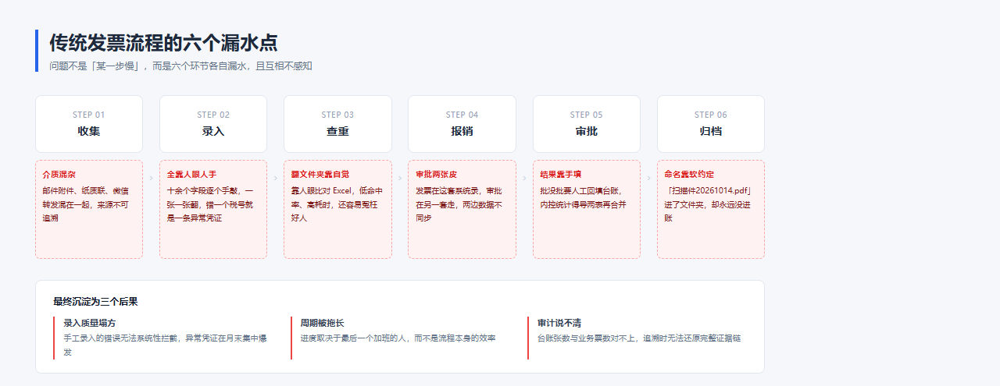
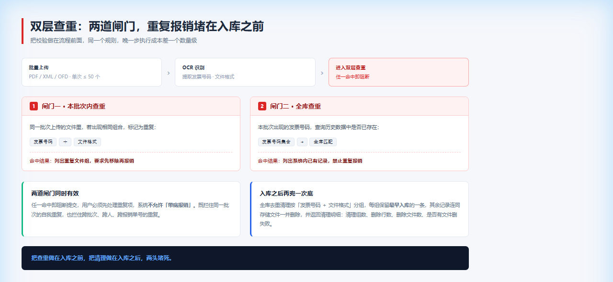
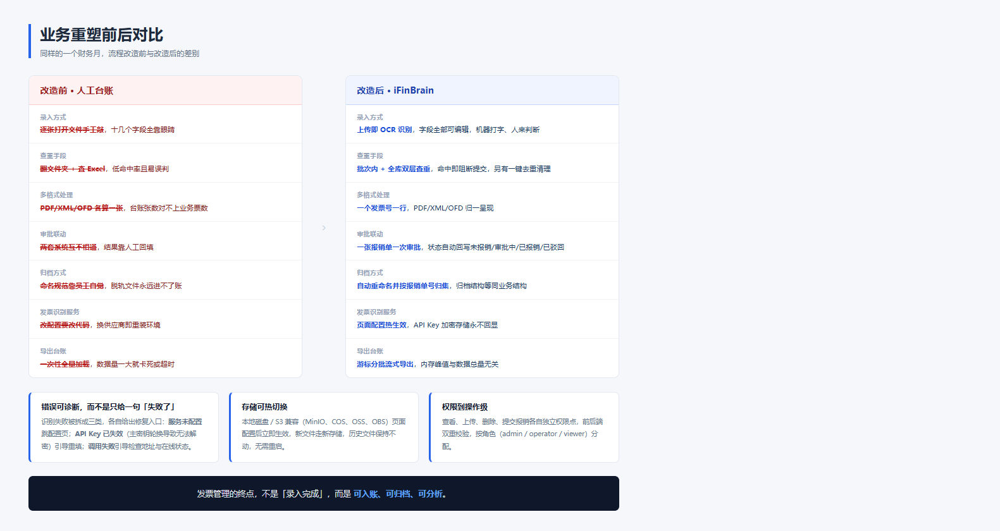

# 业务重塑系列之一：发票管理及入账报销

> 系列导读：这是「业务重塑系列」的第一篇。我们不谈技术架构，不谈模型选型，只谈一件事——**一张发票从拿到手到真正入账，中间到底有多少环节在漏水，以及怎么把这些环节重新焊死。**

---

<!-- ============ 以下为发布辅助信息，正文可删 ============ -->

**备选标题**

1. 业务重塑之一：发票管理及入账报销（系列开篇，建议用这个）
2. 数电票时代，发票管理必须重做了
3. 财务最痛的不是加班，是发票流程在漏水
4. 从录入到入账：发票流程的六个漏水点与焊死方案

**一句话摘要**

数电票全面推广之后，「以数治税」让票据合规的容错空间大幅压缩。本文把企业发票流程拆成六个漏水点，并用 iFinBrain 的实践逐一给出重塑方案。

**建议标签**

`#业务重塑` `#发票管理` `#财务数字化` `#数电票` `#报销流程` `#入账归档` `#OCR识别` `#企业内控` `#iFinBrain`

**封面图**（公众号 2.35:1，已按 2 倍分辨率 **1800×766** 输出，可直接上传）

| 版本 | 文件 | 风格 | 适用 |
|---|---|---|---|
| A（推荐） | `images/cover-A-发票管理及入账报销.png` | 左侧大字标题 + 右侧发票流转，品牌蓝紫，明亮底 | 偏正式，适合系列文章统一封面 |
| B | `images/cover-B-改造前后对比.png` | 左右「漏水 / 闭环」强对比，顶部深色系列条 | 冲击力更强，适合首发或朋友圈转发 |

> 正文配图（01–04）为 1280px 宽，博客正文栏通常 750–1080px，够用无需重出。
> 封面若要更高分辨率：把 `images/src/cover-*.html` 里的 `zoom:2` 改成 `zoom:3`，
> 并把 `normalize_cover.py` 的默认 target 改成 `(2700,1149)` 重跑。
> 注意：截图接口单边上限 1920px，3 倍在本机可能触发裁切，2 倍是稳妥值。
> html 的洋红底是渲染边界标记，不要改成透明。

**配图清单**

| 序号 | 文件 | 内容 | 位置 |
|---|---|---|---|
| 图 1 | `images/01-现状痛点地图.png` | 传统流程六环节 + 六个漏水点 + 三个后果 | 第三节「六个真实的漏水点」开头 |
| 图 2 | `images/02-iFinBrain发票处理流水线.png` | 六步处理流水线 + 「为什么识别不直接落库」 | 第四节「重塑方案」开头 |
| 图 3 | `images/03-双层查重机制.png` | 两道查重闸门 + 入库后兜底清理 | 第四节「第 3 步 双层查重」 |
| 图 4 | `images/04-改造前后对比.png` | 改造前后 7 项逐条对照 + 三项工程能力 | 第五节「改造前后」 |

> 正文中另有 5 处 `📸 截图占位` 标记，待环境就绪后补真实界面图：上传识别页、重复阻断卡片、归档结构示意、发票列表分组页、台账对照。

<!-- ============ 发布辅助信息结束 ============ -->

---

## 一、先说一个人人都经历过的场景

月末最后三天，财务同事的桌面长这样：

一摞 PDF/OFD/XML 文件，一张一张打开，对着手电筒看——发票号码是多少？销售方全称是什么？价税合计多少？开票日期哪天？

然后把这些字符，一个一个敲进 Excel。

敲到第 80 张的时候，有人发现自己把同一张发票敲了两次。于是回头翻，找了两个小时，最后在某个文件夹的「新建文件夹(3)」里发现了它。

这就是绝大多数企业发票管理的日常。听起来像段子，但拆开看，它其实是一套**已经运行了很多年、却没有被真正设计过的流程**。

而现在，这套流程正在被强制推倒重来。

---

## 二、为什么是现在：数电票不给留余地

2026 年，全面数字化的电子发票（数电票）已经从试点区域走向全国推广，传统纸质发票和税控电子发票正在加速退出。

这件事对企业财务的影响，不是「多了一个开票工具」，而是**底层约束变了**：

| 政策变化 | 对财务的实际含义 |
|---|---|
| **去税控化** | 开票不再依赖税控设备，额度赋码动态管理，额度不足就得提前申请 |
| **红冲线上化** | 红字发票确认与冲红全程线上操作，时限比过去更紧，处理慢了会影响当月申报 |
| **数据实时归集** | 发票数据经电子发票服务平台实时归集，**「以数治税」能力增强，票据合规的容错空间被大幅压缩** |

最后一条最要命。过去「先入账、回头补手续」的粗放做法还能混日子，现在不行了。发票数据的比对、勾稽越来越自动，靠人工肉眼看、靠 Excel 对，每一个小疏漏都可能变成申报错误和稽查风险。

更现实的是操作体验的割裂。业内的调研反馈很一致：企业的财务系统（比如 SAP）与数电票平台的对接并不稳定，月底批量开票集中爆发时异常频发；额度管理、跨平台适配、批量开票，都是被反复吐槽的高频堵点。

于是很多企业财务的反应是：**既然机器不好用，那就让人加班扛。**

加班扛的结果是什么？录入质量下降、周期拉长、错误累积、审计时说不清。

**业务必须重塑，不是效率优化，是结构问题。**

---

## 三、六个真实的漏水点

我把企业发票流程拆开，发现问题不是「某一步慢」，而是**六个环节各自漏水，且互相不感知**。

> 📸 **截图占位**：传统流程 vs 系统流程的台账对照，可插入现有 Excel 台账截图

### 漏水点 1｜录入环节：全靠人眼和人手

发票上的字段——发票号码、票种、开票日期、销售方名称与税号、购买方名称与税号、不含税金额、税额、价税合计（大写）、收款人、复核人、开票人——少说十几个。

一张发票一次录入，几十秒到两分钟。一家中等规模企业一个月几百上千张，**仅录入就是几十小时的纯人力消耗**，而且错一个税号就是一条异常凭证。

### 漏水点 2｜查重环节：靠人眼翻文件夹

重复报销是财务和内控最头疼的问题之一。常见场景：同一张发票被两个部门分别提交；同一张票的 PDF 版和 XML 版被当成两张票分别报销；员工二次报销时忘了上次的单。

没有系统级查重时，这些只能靠「翻文件 + 查 Excel + 问同事」，**低命中率、高耗时、还容易冤枉好人**。

### 漏水点 3｜格式环节：一张票躺着三份文件

数电票时代，**同一张发票往往同时存在 PDF（版式）、XML（结构化数据）、OFD（版式）三种格式**。财务手工归档时，这三个文件会变成三条独立记录。

于是台账里的「发票张数」和实际业务票数永远对不上，月底统计时还要额外做一次去重映射。

### 漏水点 4｜报销与审批：两张皮

很多企业的报销走 OA、发票管理走另一个系统。结果是：发票在这边录了，审批在那边走，**两边数据不同步**。

财务要手动把审批结果回填到发票台账；员工想知道「我的单批了没」，要去查 OA；内控想统计「哪些票已报销」，得导两个表再合并。

### 漏水点 5｜归档环节：靠命名规范这种「软约定」

成熟企业会要求员工把文件命名成 `发票号_报销单号.pdf`。听起来很美，实际执行率取决于员工的自觉。

一旦有人图省事叫了 `扫描件20261014.pdf`，这份发票在归档时就永久脱离了体系——**它进了文件夹，但没进账**。

### 漏水点 6｜电子档案环节：只把「打印」换成了「存电脑」

现行规定下，满足真实性、完整性、可用性、安全性要求的电子发票，可以仅以电子形式保存归档，不再强制打印。

但前提是**企业建立配套的档案管理制度**：谁来归档、怎么备份、如何调阅、权限怎么控制。

现实是大量单位制度跟不上，电子归档只是把纸质堆变成了电脑里的文件夹堆，合规风险一点没降。

---

## 四、重塑方案：把六个漏水点逐个焊死

上面六个漏水点，其实指向同一件事——**发票的「结构化数据」和「原始文件」从来没有被绑定在一起管理**。

重塑的思路也很直接：让文件进来的时候就把数据结构化，让数据产生的时候就带上有业务含义的归档路径，让查重发生在入库之前而不是出事之后。

这里以我们做的 **iFinBrain**（发票批量识别与报销管理系统）为例，看这套流程是怎么落地的。

### 第 1 步｜上传即识别，但不立即入库

支持 PDF / XML / OFD 批量拖入（单次最多 50 个文件），上传后自动调用 OCR 服务解析票面字段。

这里有个关键设计：**识别阶段只写临时存储，不落业务库**。

前端展示识别结果表，用户逐条核对、修正后，才点「报销」正式入库。

> 为什么这么设计？因为 OCR 一定有识别不准的时候。如果识别结果直接落库，错误数据就污染了账——清理的成本远高于复核的成本。
> 「先看清楚，再落账」是这套流程的底层原则。

> 📸 **截图占位**：上传识别页 —— 拖拽区 + 识别结果可编辑表格（发票号/费用类别/销售方/金额等字段均可在页面上直接修正）

### 第 2 步｜识别结果可编辑，字段结构化

识别回来的字段**全部可以在页面上直接改**：发票号码、票种、费用类别、销售方名称与税号、购买方名称与税号、不含税金额、税额、价税合计、大写金额、收款人、复核人、开票人。

OCR 负责「打字」，人负责「判断」。分工清楚，效率才上得去。

同时系统会从解析结果中提取**费用类别标签**，这是后续做费用分析、做进项结构化的基础字段。

### 第 3 步｜双层查重，两道闸门

这是整套流程里**最值钱的一个设计**。

**第一道：本批次内查重。** 同一批次上传里，出现相同「发票号码 + 文件格式」的，标记为重复。

**第二道：全库查重。** 本批次里的发票号，如果已经存在于系统历史数据中，直接列出来。

两道闸门任一命中，**就阻断报销流程**——用户必须先处理掉重复项，系统不允许「带病提交」。

除此之外，系统还提供全库去重清理能力：按「发票号码 + 文件格式」分组，每组保留最早入库的一条，其余记录连同存储文件一并删除，并返回清理明细（清理了几组、删了几行、删了几个文件、有没有文件删失败）。

**把查重做在入库之前，把清理做在入库之后，两头堵死。**

> 📸 **截图占位**：重复发票阻断卡片 —— 本批次重复 + 系统内已存在，两类分别提示

### 第 4 步｜报销三件套，把业务语义打上

用户点「报销」，弹出的表单只有核心三件套：**报销单号、报销人、报销日期**。

选填项包括动态的**报销申请单**（表单结构可配置）和**是否发起审批**开关。

「发起审批」打开后，这批发票状态变为「审批中」，走完审批才转「已报销」；不打开则提交即完成。

> 一个小细节值得说：流程的业务键用的是**报销单号**而不是发票号。因为一次提交往往含多张发票、共用一个报销单号——**一张报销单 = 一个流程实例，审批人点一次「通过」就行**，不需要为每张票点一遍。

### 第 5 步｜自动重命名 + 按单归档

确认报销的瞬间，系统做两件事：

1. **重命名文件**：`发票号码_报销单号.扩展名`
2. **写入归档路径**：`fapiao/{报销单号}/{新文件名}`

注意这里的设计选择：**按报销单号归档，而不是按年/月归档**。

按年月归档在单据量小的时候直观，但报销是一个持续发生的业务，一张单散落在年月的某个角落，很难汇总。按报销单号归档，则天然形成了「一个业务单元 = 一个文件夹」，**归档结构直接对应业务结构**。

从此以后，「这个月的差旅都花了多少」不是一个查询问题，而是「把这几个文件夹的台账拉出来」。

> 📸 **截图占位**：归档结构示意图 —— fapiao/报销单号/发票号_报销单号.pdf

### 第 6 步｜一张票一行，多格式归一

列表页按**发票号码分组**——同一个发票号码下的 PDF / XML / OFD 合并成一行，各格式用标识展示可用与不可用。

这直接消灭了前面说的「漏水点 3」：**台账里的发票张数从此等于业务上的实际票数**。

> 📸 **截图占位**：发票列表页 —— 分组视图 + PDF/XML/OFD 三格式标识 + 报销状态列

---

## 五、改造前后：一张表看清差异

还有一些容易被忽略、但对企业很关键的工程能力：

**解析服务可插拔。** OCR 服务的 Base URL、API Key、超时、接口路径全部在页面上配置，热生效，不改代码不发版。API Key 用 AES-256-GCM 加密存储（AES-256-GCM，落库字段带 `_enc` 后缀），接口永不回显明文，页面只显示掩码和三态提示（未配置 / 已配置 / 密钥失效）。

**错误可诊断，而不是给一个「失败了」。** 识别失败会被分类成三种并各自给出修复入口：
- 识别 API 未配置 → 直接跳配置页
- API Key 已失效（主密钥轮换导致无法解密）→ 引导重新填写
- 调用识别服务失败 → 引导检查 Base URL 与在线状态

**批量导出不会把服务器拖垮。** CSV / Excel 导出采用游标分批（每批 1000 条）+ 流式写入，**JVM 堆峰值与数据总量无关**——导出十万条和导出一万条，内存占用是同一个量级。

**存储可热切换。** 本地磁盘 / S3 兼容（MinIO、腾讯云 COS、阿里云 OSS、华为云 OBS 等），页面配置后立即生效，老文件不动。

**权限到操作级。** 查看、上传、删除、提交报销各自独立权限点，前后端双重校验。

---

## 六、业务重塑的通用启示

回头看，发票管理这个场景其实提供了一个很典型的「业务重塑」样本：

**第一，不要在坏流程上做效率优化。** 「录入快一点」的收益，远小于「让人不必录」。

**第二，把校验做在流程前面。** 查重放在报销动作之前，而不是出事之后的审计环节——同一个规则，晚一步执行，成本差一个数量级。

**第三，让结构跟随业务，而不是跟随习惯。** 按年月归档是历史习惯，按报销单号归档才是业务结构。数据结构的改动成本，远高于它带来的长期收益。

**第四，能结构化的不要留给人。** 电子档案的合规前提是制度，而制度的执行载体是系统。制度写在墙上叫倡议，写在流程里才叫控制。

---

## 七、小结

数电票时代，票据管理的重心正在从「开票」转向「管票」。

「会开票」是操作，学几天就会；**「会管票」是能力**——它需要归集、比对、归档、分析四套本事做支撑，而这四套本事，没有一样能靠加班堆出来。

发票是所有财务数字里**唯一一个既携带完整业务语义、又天然带版式凭证**的载体。管好了它，从单据到账目到分析就通了；管不好，Excel 表格就会一直是财务甩不掉的历史包袱。

这也是我们做 iFinBrain 时最核心的一个判断：**发票管理的终点不是「录入完成」，而是「可入账、可归档、可分析」。**

---

### 如果你也正被发票台账折磨

iFinBrain 是一套开箱即用的发票批量识别与报销管理系统，基于 Spring Boot 4.1 + Vue 3 构建，OCR 解析、查重阻断、报销归档、审批流集成、电子台账导出打通闭环，存储层支持本地磁盘与 S3 兼容对象存储热切换。

- **上传即识别**，字段可编辑，识别错不怕
- **双层查重**，重复报销在入库前就被挡住
- **一键归档**，按报销单号自动重命名并归集
- **审批集成**，一张报销单一次审批，状态自动回写
- **流式导出**，十万条数据不撑爆内存

如果你正在为数电票切换、发票台账核对、重复报销审计头疼，欢迎聊聊实际场景——**业务重塑这件事，最怕的就是只在纸上重塑。**

---

**互动**：你们公司的发票流程，卡得最狠的是哪一步？是录入、查重，还是归档？欢迎在评论区聊聊真实的坑，我挑典型的写成下一篇。

---

*本文是「业务重塑系列」第一篇，后续将拆解低代码表单设计、流程引擎、数据权限与经营分析等主题。*